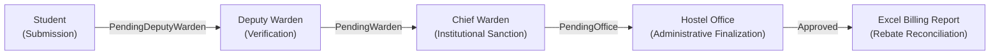
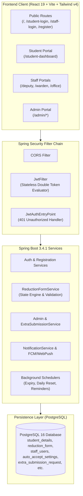
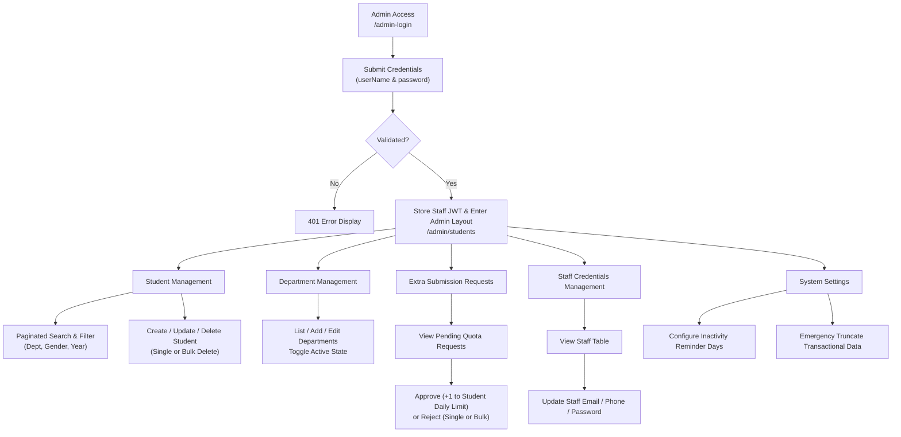
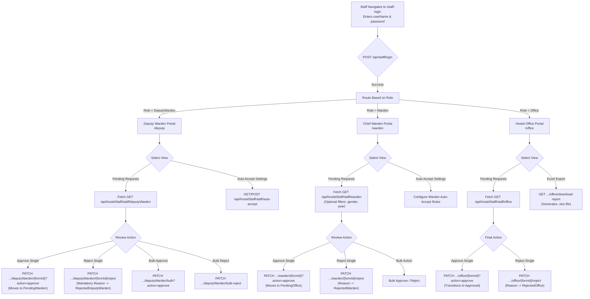
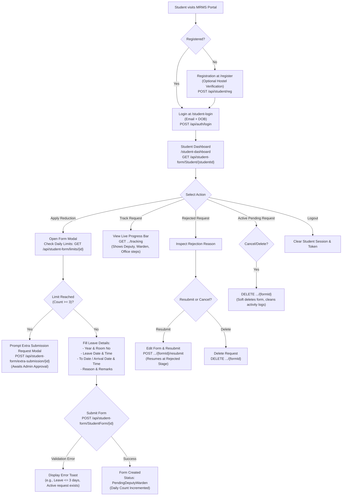
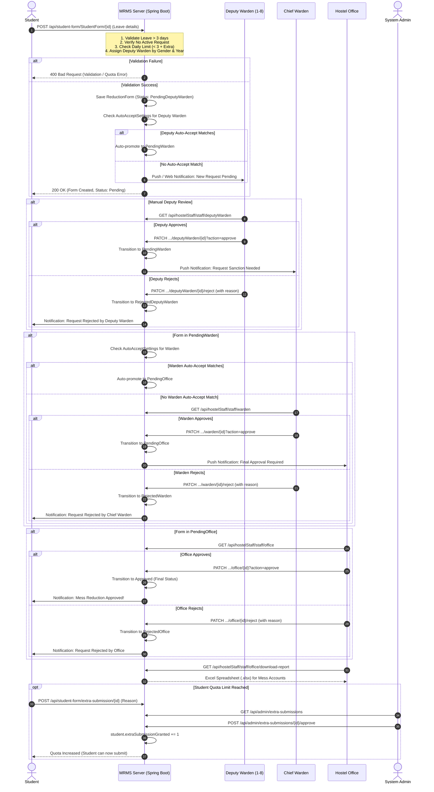
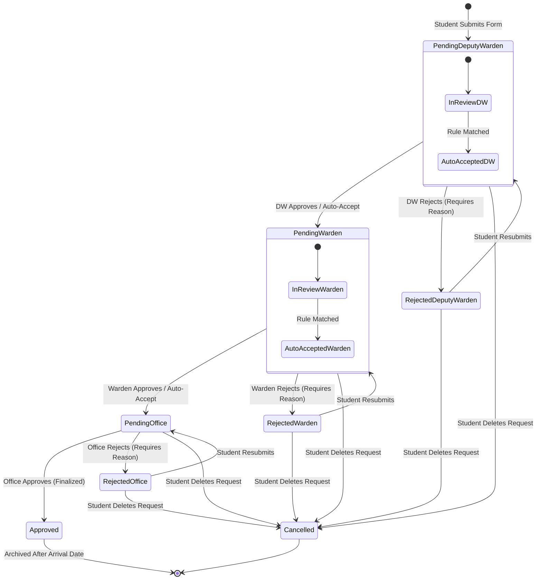
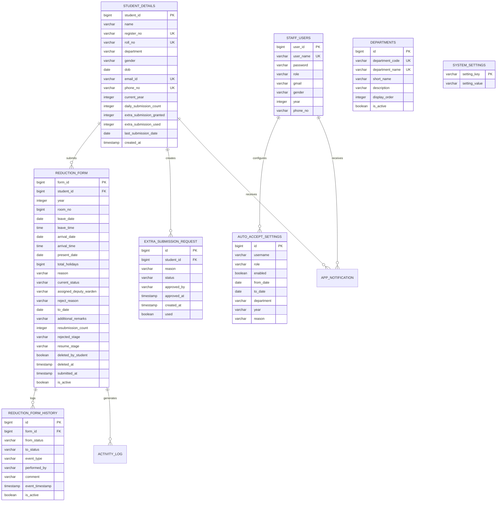
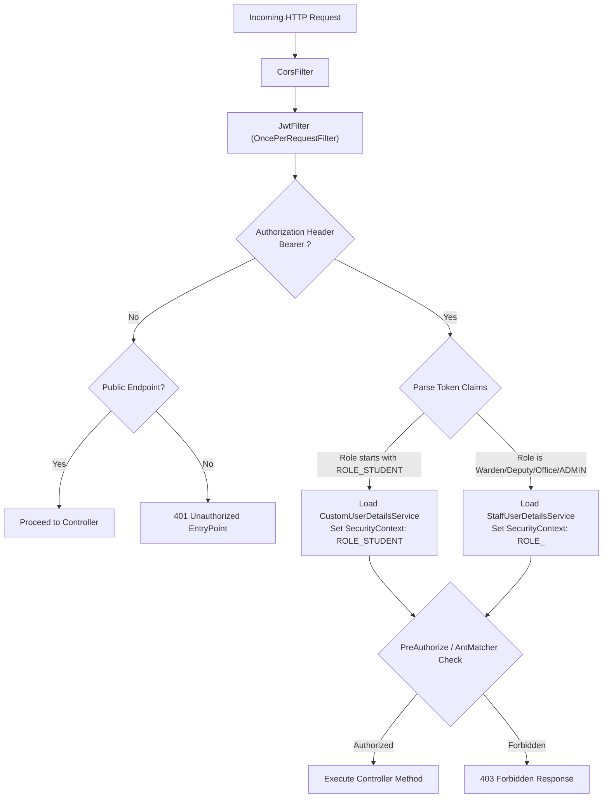

# Mess Reduction Management System (MRMS)
## Complete Technical Architecture and Multi-Role Workflow Documentation

---

### Document Control & Metadata
- **Project Name:** Mess Reduction Management System (MRMS)
- **Document Version:** 1.0.0
- **Document Type:** System Workflow & Technical Architecture Specification
- **Target Audience:** College Administration, Hostel Authorities, Technical Evaluators, System Administrators, and Developers
- **Technology Stack:**
  - **Backend:** Java 21, Spring Boot 3.4.1, Spring Data JPA, Hibernate, PostgreSQL, Spring Security, JJWT (Double Auth Provider), Apache POI, Firebase Admin SDK (FCM)
  - **Frontend:** React 19, Vite, Tailwind CSS v4, Lucide React, Framer Motion, Axios

---

## Table of Contents
1. [Project Overview](#1-project-overview)
2. [Project Objectives](#2-project-objectives)
3. [User Roles and Responsibilities](#3-user-roles-and-responsibilities)
4. [System Architecture Overview](#4-system-architecture-overview)
5. [Admin Workflow](#5-admin-workflow)
6. [Staff Workflow](#6-staff-workflow)
7. [Student Workflow](#7-student-workflow)
8. [End-to-End Business Workflow](#8-end-to-end-business-workflow)
9. [Request Status Lifecycle](#9-request-status-lifecycle)
10. [Database Entity Relationships](#10-database-entity-relationships)
11. [API Workflow and Endpoint Reference](#11-api-workflow-and-endpoint-reference)
12. [Authentication and Authorization](#12-authentication-and-authorization)
13. [Business Rules and Validations](#13-business-rules-and-validations)
14. [Error Handling](#14-error-handling)
15. [Existing Limitations and Missing Features](#15-existing-limitations-and-missing-features)
16. [Conclusion](#16-conclusion)

---

## 1. Project Overview

The **Mess Reduction Management System (MRMS)** is an enterprise web application designed to digitize and automate the multi-tiered hostel leave and mess rebate approval process in collegiate hostel environments. 

Traditionally, hostel students submit physical paper slips to take leaves and claim mess fee reductions for consecutive days of absence. This conventional manual workflow suffers from paperwork delays, lack of status transparency, manual verification errors, arbitrary approval timelines, and error-prone billing reconciliation at the hostel office.

MRMS replaces paper forms with a three-tier hierarchical digital verification pipeline:
1. **Deputy Warden Level:** Verification of student year, gender cohort, and initial leave feasibility.
2. **Chief Warden / Warden Level:** Institutional verification and leave authority sanctioning.
3. **Hostel Office Level:** Final administrative verification and preparation of mess fee rebate records.

The application incorporates automated rule-based decision engines (Auto-Accept), background schedulers for automated request expiry and submission quotas, push notifications (via Firebase Cloud Messaging and Web Push), and exportable Excel reports for mess billing accounts.



---

## 2. Project Objectives

1. **Elimination of Paper-Based Processes:** Transition from handwritten leave slips to an auditable digital trail.
2. **Transparent Multi-Tier Approvals:** Grant students real-time status tracking across every stage of the approval hierarchy.
3. **Automated Quota & Policy Enforcement:** Automatically enforce institutional rules:
   - Minimum absence threshold (> 3 days).
   - Maximum active request constraints (1 active non-rejected request at any given time).
   - Daily submission quotas (3 attempts per day).
4. **Cohort-Specific Routing:** Automatically route requests based on student gender and academic year to the designated Deputy Warden (1 through 8).
5. **Rule-Based Automation:** Enable Warden and Deputy Warden authorities to configure automatic acceptance rules for mass leaves (holidays, exam leaves, department events).
6. **Billing Accuracy:** Provide the hostel accounting office with structured, tamper-proof, and exportable reduction records to compute fee deductions accurately.
7. **Administrative Governance:** Equip the System Administrator with capabilities to manage student records, staff credentials, academic departments, and grant exceptional submission allowances.

---

## 3. User Roles and Responsibilities

The system defines four distinct security authorities across three operational role categories:

| Operational Role | Security Role Key | Level / Scope | Primary Responsibilities |
| :--- | :--- | :--- | :--- |
| **System Administrator** | `ROLE_ADMIN` | Global System Scope | • Full student CRUD & bulk deletion<br>• Staff credential management & password resets<br>• Academic department maintenance<br>• Approval/rejection of quota increase requests<br>• System-wide reminder offset configuration |
| **Deputy Warden** | `ROLE_DeputyWarden` | Cohort Scope (Gender & Year Specific) | • Review incoming leave requests for assigned cohort (DW 1 to 8)<br>• Validate leave dates, reason, and student details<br>• Approve or reject (with mandatory reason)<br>• Bulk approve / bulk reject pending forms<br>• Configure auto-accept criteria for cohort |
| **Chief Warden / Warden** | `ROLE_Warden` | Institutional Scope (All / Year Cohort) | • Second-level leave validation<br>• Institutional leave sanctioning<br>• Bulk approval and rejection processing<br>• Configure institutional auto-accept rules<br>• Monitor year-wise leave statistics |
| **Hostel Office Staff** | `ROLE_Office` | Administrative & Billing Scope | • Final approval stage (`PendingOffice` -> `Approved`)<br>• Validation against mess hall rosters<br>• Generate and export Excel billing reports<br>• Mass purge/cleanup of old archival records |
| **Student** | `ROLE_STUDENT` | Individual Scope | • Register account (with optional hostel verification)<br>• Authenticate using Email + Date of Birth<br>• Submit mess reduction applications (> 3 days)<br>• Track live request status and view rejection reasons<br>• Edit and resubmit rejected applications<br>• Request daily quota overrides from Admin |

### Cohort Assignment Matrix (Deputy Wardens)

The system automatically assigns submissions using a deterministic routing table based on student demographic properties:

```
+------------+-------------+-----------------------+
| Gender     | Academic Yr | Assigned Deputy Warden|
+------------+-------------+-----------------------+
| MALE       | 1st Year    | deputyWarden1         |
| MALE       | 2nd Year    | deputyWarden2         |
| MALE       | 3rd Year    | deputyWarden3         |
| MALE       | 4th Year    | deputyWarden4         |
| FEMALE     | 1st Year    | deputyWarden5         |
| FEMALE     | 2nd Year    | deputyWarden6         |
| FEMALE     | 3rd Year    | deputyWarden7         |
| FEMALE     | 4th Year    | deputyWarden8         |
+------------+-------------+-----------------------+
```

---

## 4. System Architecture Overview

MRMS is built on a decoupled Client-Server architecture utilizing RESTful communication over HTTP/JSON and stateless token authorization.



### Architectural Component Highlights
- **Stateless Dual JWT Model:** The application implements two distinct JWT signing strategies:
  1. `JwtUtil`: Signs tokens for students containing `studentId`, `email`, and `ROLE_STUDENT`.
  2. `StaffJwtUtil`: Signs tokens for staff containing `userName`, `email`, and assigned `ROLE_` (`ROLE_Warden`, `ROLE_DeputyWarden`, `ROLE_Office`, or `ROLE_ADMIN`).
- **Dynamic Scheduled Workers:**
  - `ReductionFormExpiryScheduler`: Runs continuously every minute to mark requests whose `arrivalDate` and `arrivalTime` have lapsed as `isActive = false`.
  - `DailyResetScheduler`: Fires at `00:00:00 IST` every night to clear daily submission counts.
  - `ReminderNotificationScheduler`: Evaluates aging requests and escalates alerts to designated authorities.
- **Reporting Engine:** Uses Apache POI for streaming Excel workbook generation from the JPA entity state.

---

## 5. Admin Workflow

The System Administrator governs master data, staff provisioning, system parameters, and quota exception requests.



### Step-by-Step Admin Procedures

1. **Authentication:**
   - Navigates to `/admin-login`.
   - Inputs administrative credentials (`userName`, `password`).
   - System calls `POST /api/staff/login`.
   - On success, receives a staff JWT token with role `ROLE_ADMIN`.
   - Browser stores credentials in cookies (`staffToken`, `staffRole=ADMIN`) and redirects to `/admin/students`.

2. **Student Master Data Administration:**
   - **View & Filter:** Views a paginated table populated via `GET /api/admin/students` supporting keyword search (`search`), department filter (`department`), gender (`gender`), and year (`year`).
   - **Create Student:** Submits student registration via `POST /api/admin/students`.
   - **Edit Student:** Updates details via `PUT /api/admin/students/{id}`.
   - **Delete Student:** Performs single delete via `DELETE /api/admin/students/{id}` or batch deletion via `POST /api/admin/students/bulk-delete`.

3. **Academic Department Administration:**
   - Accesses `/admin/departments`.
   - Queries existing departments via `GET /api/departments?paged=true`.
   - Adds new programs (e.g., Computer Science, Mechanical) via `POST /api/departments`.
   - Modifies department metadata or toggles active status via `PUT /api/departments/{id}`.

4. **Extra Submission Request Handling:**
   - When students exceed the daily submission limit (3 forms/day), they submit an exception request with a justification.
   - Admin accesses `/admin/extra-submissions`.
   - Retrieves pending requests via `GET /api/admin/extra-submissions`.
   - Executes single approval (`POST /api/admin/extra-submissions/{id}/approve`) or batch approval (`POST /api/admin/extra-submissions/bulk-approve`).
   - Approving increments the student's `extraSubmissionGranted` counter by +1.
   - Rejection is executed via `POST /api/admin/extra-submissions/{id}/reject`.

5. **Staff Credential Provisioning:**
   - Accesses `/admin/staff-credentials` to view all registered staff (`GET /api/admin/staff-credentials`).
   - Edits contact details, email addresses, and securely rotates BCrypt-hashed passwords for Wardens, Deputy Wardens, or Office accounts via `PUT /api/admin/staff-credentials/{id}`.

6. **System Parameter & Reminder Configuration:**
   - Configures the inactivity reminder threshold via `PUT /api/admin/settings/reminder-offset` (`key="REMINDER_OFFSET_DAYS"`).
   - Maintenance utility: If authorized, performs transactional maintenance via `POST /api/admin/truncate-transactional-data` to purge transient requests while preserving master records.

7. **Logout:**
   - Admin triggers the logout action, which clears `auth_token`, `staffToken`, `staff_role`, and session cookies, redirecting to `/admin-login`.

---

## 6. Staff Workflow

The Staff Workflow governs how Deputy Wardens, Chief Wardens, and Hostel Office staff review, sanction, and finalize mess reduction requests.



### Detailed Staff Step-by-Step Workflows

#### A. Deputy Warden Workflow
1. **Authentication:** Logs in at `/staff-login`. The server verifies credentials, issues a staff JWT with authority `ROLE_DeputyWarden`, and redirects to `/deputy`.
2. **Reviewing Queue:**
   - The dashboard calls `GET /api/hostelStaff/staff/deputyWarden` to retrieve forms specifically assigned to this deputy's username (`deputyWarden1` to `deputyWarden8`).
   - The queue displays student name, roll number, department, year, room number, leave date/time, arrival date/time, total holiday days, and student reason.
3. **Single Decision:**
   - **Approve:** Executes `PATCH /api/hostelStaff/staff/deputyWarden/{formId}?action=approve`. The record transitions from `PendingDeputyWarden` to `PendingWarden`. An audit history record is generated.
   - **Reject:** Prompts for a mandatory reason string. Executes `PATCH /api/hostelStaff/staff/deputyWarden/{formId}/reject` with `{ "rejectReason": "..." }`. The form transitions to `RejectedDeputyWarden`.
4. **Batch Operations:**
   - Deputy Warden can select multiple records and invoke bulk approve (`PATCH /api/hostelStaff/staff/deputyWarden/bulk`) or bulk reject (`PATCH /api/hostelStaff/staff/deputyWarden/bulk-reject`).
5. **Auto-Accept Configuration:**
   - Deputy Warden accesses the Auto-Accept settings tab (`GET /api/hostelStaff/staff/auto-accept`).
   - Configures rules specifying `fromDate`, `toDate`, optional `department`, `year`, and matching `reason` substring.
   - Submits via `POST /api/hostelStaff/staff/auto-accept`. Any matching future student submission is immediately promoted without manual intervention.

#### B. Chief Warden / Warden Workflow
1. **Authentication:** Authenticates at `/staff-login` receiving `ROLE_Warden` and enters `/warden`.
2. **Reviewing Queue:**
   - Retrieves all requests that cleared the Deputy Warden stage (`PendingWarden`) via `GET /api/hostelStaff/staff/warden`.
   - Can filter by cohort gender and student academic year.
3. **Decision Making:**
   - **Approve:** Executes `PATCH /api/hostelStaff/staff/warden/{formId}?action=approve`. The request transitions from `PendingWarden` to `PendingOffice`.
   - **Reject:** Executes `PATCH /api/hostelStaff/staff/warden/{formId}/reject`. Transitions to `RejectedWarden`.
   - Bulk approval and bulk rejection are supported via `/api/hostelStaff/staff/warden/bulk` and `/api/hostelStaff/staff/warden/bulk-reject`.
4. **Auto-Accept Rules:** Configures institutional-level auto-acceptance for college holidays or semester breaks.

#### C. Hostel Office Workflow
1. **Authentication:** Authenticates at `/staff-login` receiving `ROLE_Office` and navigates to `/office`.
2. **Final Verification:**
   - Calls `GET /api/hostelStaff/staff/office` to view forms at `PendingOffice`.
   - Reviews requests against physical attendance and mess rosters.
3. **Approval Finalization:**
   - **Approve:** Submits `PATCH /api/hostelStaff/staff/office/{formId}?action=approve`. Form status becomes `Approved`. The student's mess rebate is officially locked in.
   - **Reject:** Submits `PATCH /api/hostelStaff/staff/office/{formId}/reject` with mandatory reason. Form status becomes `RejectedOffice`.
4. **Report Generation & Download:**
   - Retrieves active report data via `GET /api/hostelStaff/staff/office/report-data`.
   - Downloads the pre-formatted Excel workbook via `GET /api/hostelStaff/staff/office/download-report`. The binary `.xlsx` stream contains complete student identification, room numbers, leave dates, and reduction day counts for accounting deductions.

---

## 7. Student Workflow

The Student Workflow guides the student from authentication to submission, live tracking, resubmission, and cancellation.



### Detailed Student Step-by-Step Procedures

1. **Student Registration:**
   - Navigates to `/register` (or `/student-register`).
   - If hostel verification is enabled in system settings, performs verification against hostel master records via `POST /api/auth/verify-hostel`.
   - Submits registration details (`name`, `registerNo`, `rollNo`, `department`, `gender`, `dob`, `emailId`, `phoneNo`, `currentYear`) via `POST /api/student/reg`.
   - System registers the student with default submission limits (`dailySubmissionCount=0`, `extraSubmissionGranted=0`).

2. **Student Authentication:**
   - Navigates to `/student-login`.
   - Enters registered `emailId` and `dob` (Date of Birth).
   - Backend verifies credentials against database record.
   - On match, receives a Student JWT token (`ROLE_STUDENT`) and student profile object.
   - Stored in browser `localStorage` (`auth_token`, `user_type=STUDENT`, `student_data`) and `sessionStorage`. Redirects to `/student-dashboard`.

3. **Dashboard Initialization:**
   - Invokes `GET /api/student-form/Student/{studentId}` to retrieve student profile, current server time (`Asia/Kolkata`), daily quota counters, and list of existing reduction forms.
   - Fetches quota limits via `GET /api/student-form/limits/{studentId}` to determine form submission eligibility.

4. **Submitting a Mess Reduction Application:**
   - Student clicks **Apply for Mess Reduction**.
   - Inputs required parameters:
     - **Academic Year:** (1, 2, 3, or 4).
     - **Room Number:** Numerical room identifier.
     - **Leave Date & Leave Time:** Date and time of hostel departure.
     - **Arrival Date & Arrival Time:** Expected date and time of return.
     - **To Date (Optional):** End date of leave period.
     - **Reason:** Mandatory descriptive justification.
     - **Additional Remarks:** Optional notes.
   - **Form Submission Validation Rules:**
     - `leaveDate` cannot be in the past.
     - `toDate` must be greater than or equal to `leaveDate`.
     - `arrivalDate` must be greater than or equal to `toDate`.
     - Total leave days (`ChronoUnit.DAYS.between(leaveDate, endDate)`) must be **strictly greater than 3 days**.
     - Eligible reduction days calculated as: `totalHolidays = totalDays - 3`.
     - Student must have **no active pending or approved requests** currently running.
   - Submits via `POST /api/student-form/StudentForm/{studentId}`.
   - Form is created with status `PendingDeputyWarden` and automatically assigned to the designated Deputy Warden.
   - Daily submission count increments by 1.

5. **Quota Exception (Extra Submission Request):**
   - If the student has submitted 3 times within the current day (`dailySubmissionCount >= 3 + extraSubmissionGranted`), normal submission is blocked.
   - The UI surfaces the **Request Extra Submission** modal.
   - Student submits a justification via `POST /api/student-form/extra-submission/{studentId}`.
   - An `ExtraSubmissionRequest` is registered in `PENDING` status awaiting Admin review.

6. **Tracking Application Status:**
   - Student selects a submitted form and views tracking details via `GET /api/student-form/StudentForm/{studentId}/{formId}/tracking`.
   - The tracking interface displays a visual timeline across:
     1. Form Submitted (Timestamp, Initial State)
     2. Deputy Warden Review (Pending / Approved / Rejected)
     3. Chief Warden Review (Pending / Approved / Rejected)
     4. Hostel Office Review (Pending / Approved / Rejected)
   - Real-time audit logs are accessible via `GET /api/student-form/StudentForm/{studentId}/{formId}/history`.

7. **Handling Rejections & Resubmission:**
   - If rejected, the status changes to `RejectedDeputyWarden`, `RejectedWarden`, or `RejectedOffice`.
   - The student inspects the rejection reason provided by the staff member.
   - Student clicks **Edit / Resubmit**.
   - Form data is retrieved via `GET /api/student-form/StudentForm/{studentId}/{formId}`.
   - Student updates dates or clarifies reason and posts via `POST /api/student-form/StudentForm/{studentId}/{formId}/resubmit`.
   - **Key Architectural Behavior:** The form resumes at the exact stage it was rejected! (e.g., a form rejected by Office resumes at `PendingOffice`, bypassing Deputy and Warden re-approval).
   - Resubmission increments `resubmissionCount` by 1.

8. **Deleting / Cancelling Requests:**
   - Students can cancel/delete pending or rejected requests via `DELETE /api/student-form/StudentForm/{studentId}/{formId}`.
   - Soft delete occurs (`isActive = false`, `deletedByStudent = true`, `deletedAt = now()`).
   - Approved requests **cannot** be deleted by the student.

---

## 8. End-to-End Business Workflow

The following comprehensive sequence diagram illustrates the lifecycle of a mess reduction application across all actors, validation checkpoints, and notification pipelines.



---

## 9. Request Status Lifecycle

The system employs a finite state machine governed by the `FormStatus` enumeration:

```
PendingDeputyWarden ──(DW Approve)──> PendingWarden ──(Warden Approve)──> PendingOffice ──(Office Approve)──> Approved
        │                                    │                                   │
   (DW Reject)                         (Warden Reject)                     (Office Reject)
        │                                    │                                   │
        ▼                                    ▼                                   ▼
RejectedDeputyWarden                  RejectedWarden                      RejectedOffice
        │                                    │                                   │
        └─────────────────(Student Resubmit Resumes Stage)───────────────────────┘
```



### Status Definition Table

| Status Constant | Human Label | Permitted Transitions | Description |
| :--- | :--- | :--- | :--- |
| `PendingDeputyWarden` | Pending Deputy Warden | `PendingWarden`, `RejectedDeputyWarden`, Soft Delete | Form submitted by student. Awaiting verification by assigned cohort Deputy Warden. |
| `PendingWarden` | Pending Chief Warden | `PendingOffice`, `RejectedWarden`, Soft Delete | Approved by Deputy Warden. Awaiting institutional sanction by Chief Warden. |
| `PendingOffice` | Pending Hostel Office | `Approved`, `RejectedOffice`, Soft Delete | Sanctioned by Chief Warden. Awaiting final administrative verification by Hostel Office. |
| `Approved` | Approved | Terminal State (No Student Edits/Deletes) | Officially approved by all three authorities. Eligible for mess rebate deduction in billing. |
| `RejectedDeputyWarden` | Rejected by Deputy Warden | `PendingDeputyWarden` (Resubmit), Soft Delete | Rejected at tier 1. Student must review reason, edit details, and resubmit. |
| `RejectedWarden` | Rejected by Chief Warden | `PendingWarden` (Resubmit), Soft Delete | Rejected at tier 2. Resubmission routes directly back to Chief Warden tier. |
| `RejectedOffice` | Rejected by Hostel Office | `PendingOffice` (Resubmit), Soft Delete | Rejected at tier 3. Resubmission routes directly back to Hostel Office tier. |

---

## 10. Database Entity Relationships

The relational data model consists of 14 core entities managed via Hibernate and JPA annotations on PostgreSQL.



### Entity Schema Summary

1. `StudentDetails`: Master record for enrolled hostel students. Enforces unique constraints on `registerNo`, `rollNo`, `emailId`, and `phoneNo`. Contains state variables for the daily rate limiter (`dailySubmissionCount`, `extraSubmissionGranted`, `lastSubmissionDate`).
2. `ReductionForm`: The central transaction record. Stores leave dates, timestamps, calculated reduction days (`totalHolidays`), approval stage markers (`rejectedStage`, `resumeStage`), and soft-deletion flags.
3. `ReductionFormHistory`: Audit trail recording state transitions (`fromStatus` -> `toStatus`), actor usernames, timestamps, and justification comments.
4. `StaffUsers`: Stores authority profiles (`Warden`, `DeputyWarden`, `Office`, `ADMIN`) along with assigned cohort parameters (`gender`, `year`).
5. `AutoAcceptSettings`: Defines parameter criteria (`fromDate`, `toDate`, `department`, `year`, `reason`) under which the system auto-promotes student requests.
6. `ExtraSubmissionRequest`: Tracks requests submitted by students to exceed the daily 3-request ceiling.
7. `Department`: Master table for academic programs, sorting order, and active flags.
8. `SystemSettings`: Key-value store for application runtime configuration (e.g., `REMINDER_OFFSET_DAYS`).

---

## 11. API Workflow and Endpoint Reference

### 11.1 Authentication & Registration Endpoints

| HTTP Verb | Path | Security / Role | Request Payload | Response / Status |
| :--- | :--- | :--- | :--- | :--- |
| `POST` | `/api/auth/login` | Public | `{ emailId, dob }` | `200 OK`: `{ token, studentId, name, ... }` |
| `POST` | `/api/auth/verify-hostel` | Public | `{ registerNo, rollNo }` | `200 OK`: `{ verified: true, studentInfo }` |
| `GET` | `/api/auth/hostel-verification-status` | Public | None | `200 OK`: `{ enabled: boolean }` |
| `POST` | `/api/student/reg` | Public | `StudentDetailsReqDTO` | `200 OK`: `StudentDetailsResDTO` |
| `POST` | `/api/staff/login` | Public | `{ userName, password }` | `200 OK`: `{ token, username, role, ... }` |
| `GET` | `/api/staff/validate` | Authenticated Staff | None (Bearer Token) | `200 OK`: `{ valid: true, role, username }` |

### 11.2 Student Mess Reduction Endpoints

| HTTP Verb | Path | Security / Role | Purpose / Description |
| :--- | :--- | :--- | :--- |
| `GET` | `/api/student-form/server-time` | `ROLE_STUDENT` | Returns current IST date, time, and time zone. |
| `GET` | `/api/student-form/Student/{studentId}` | `ROLE_STUDENT` | Fetches student profile, quota counts, and all active forms. |
| `POST` | `/api/student-form/StudentForm/{studentId}` | `ROLE_STUDENT` | Submits a new reduction request. Validates leave > 3 days. |
| `GET` | `/api/student-form/StudentForm/{studentId}` | `ROLE_STUDENT` | Retrieves all reduction requests submitted by the student. |
| `GET` | `/api/student-form/StudentForm/{studentId}/{formId}` | `ROLE_STUDENT` | Retrieves form data for editing (rejected forms only). |
| `POST` | `/api/student-form/StudentForm/{studentId}/{formId}/resubmit` | `ROLE_STUDENT` | Resubmits an edited rejected form. Resumes at rejected stage. |
| `GET` | `/api/student-form/StudentForm/{studentId}/{formId}/history` | `ROLE_STUDENT` | Returns state change history logs for the given form. |
| `GET` | `/api/student-form/StudentForm/{studentId}/{formId}/tracking` | `ROLE_STUDENT` | Retrieves visual tracking step details. |
| `DELETE` | `/api/student-form/StudentForm/{studentId}/{formId}` | `ROLE_STUDENT` | Soft deletes a pending or rejected request. |
| `GET` | `/api/student-form/limits/{studentId}` | `ROLE_STUDENT` | Returns current daily submission count and remaining allowance. |
| `POST` | `/api/student-form/extra-submission/{studentId}` | `ROLE_STUDENT` | Submits an exception request to increase daily quota. |
| `GET` | `/api/student-form/extra-submission/{studentId}` | `ROLE_STUDENT` | Lists student's extra submission exception requests. |

### 11.3 Staff Endpoints (Deputy Warden, Warden, Office)

| HTTP Verb | Path | Security / Role | Description / Action |
| :--- | :--- | :--- | :--- |
| `GET` | `/api/hostelStaff/staff/deputyWarden` | `ROLE_DeputyWarden` | Lists pending forms assigned to the logged-in Deputy Warden. |
| `PATCH` | `/api/hostelStaff/staff/deputyWarden/{formId}` | `ROLE_DeputyWarden` | Approves request (`action=approve`). Moves to `PendingWarden`. |
| `PATCH` | `/api/hostelStaff/staff/deputyWarden/{formId}/reject` | `ROLE_DeputyWarden` | Rejects request with mandatory `{ rejectReason }`. |
| `PATCH` | `/api/hostelStaff/staff/deputyWarden/bulk` | `ROLE_DeputyWarden` | Bulk approve a list of form IDs: `[formId1, formId2]`. |
| `PATCH` | `/api/hostelStaff/staff/deputyWarden/bulk-reject` | `ROLE_DeputyWarden` | Bulk reject form IDs with a common reason. |
| `GET` | `/api/hostelStaff/staff/warden` | `ROLE_Warden` | Lists forms in `PendingWarden` (supports `gender`, `year` filters). |
| `PATCH` | `/api/hostelStaff/staff/warden/{formId}` | `ROLE_Warden` | Approves request. Moves to `PendingOffice`. |
| `PATCH` | `/api/hostelStaff/staff/warden/{formId}/reject` | `ROLE_Warden` | Rejects request with mandatory reason. |
| `PATCH` | `/api/hostelStaff/staff/warden/bulk` | `ROLE_Warden` | Bulk approves forms for Chief Warden tier. |
| `PATCH` | `/api/hostelStaff/staff/warden/bulk-reject` | `ROLE_Warden` | Bulk rejects forms for Chief Warden tier. |
| `GET` | `/api/hostelStaff/staff/office` | `ROLE_Office` | Lists forms in `PendingOffice` stage. |
| `PATCH` | `/api/hostelStaff/staff/office/{formId}` | `ROLE_Office` | Final approval. Moves form to `Approved`. |
| `PATCH` | `/api/hostelStaff/staff/office/{formId}/reject` | `ROLE_Office` | Final stage rejection with mandatory reason. |
| `PATCH` | `/api/hostelStaff/staff/office/bulk` | `ROLE_Office` | Bulk approves forms for Office tier. |
| `PATCH` | `/api/hostelStaff/staff/office/bulk-reject` | `ROLE_Office` | Bulk rejects forms for Office tier. |
| `GET` | `/api/hostelStaff/staff/office/report-data` | `ROLE_Office` | Returns JSON array of approved reduction records for billing. |
| `GET` | `/api/hostelStaff/staff/office/download-report` | `ROLE_Office` | Streams Excel workbook (`.xlsx`) containing approved records. |
| `GET` | `/api/hostelStaff/staff/auto-accept` | `ROLE_Warden`, `ROLE_DeputyWarden` | Retrieves current auto-accept configuration. |
| `POST` | `/api/hostelStaff/staff/auto-accept` | `ROLE_Warden`, `ROLE_DeputyWarden` | Saves/updates auto-accept matching rule. |
| `GET` | `/api/hostelStaff/staff/dashboard-count` | Staff Roles | Returns count of pending forms and active leave metrics. |

### 11.4 Admin Endpoints

| HTTP Verb | Path | Security / Role | Description / Action |
| :--- | :--- | :--- | :--- |
| `GET` | `/api/admin/students` | `ROLE_ADMIN` | Paginated search of students (filters: search, dept, gender, year). |
| `GET` | `/api/admin/students/{id}` | `ROLE_ADMIN` | Retrieves single student details by ID. |
| `POST` | `/api/admin/students` | `ROLE_ADMIN` | Manually creates a new student record. |
| `PUT` | `/api/admin/students/{id}` | `ROLE_ADMIN` | Updates an existing student record. |
| `DELETE` | `/api/admin/students/{id}` | `ROLE_ADMIN` | Deletes a student record. |
| `POST` | `/api/admin/students/bulk-delete` | `ROLE_ADMIN` | Batch deletes students by list of IDs. |
| `GET` | `/api/admin/extra-submissions` | `ROLE_ADMIN` | Lists all pending daily quota exception requests. |
| `POST` | `/api/admin/extra-submissions/{id}/approve` | `ROLE_ADMIN` | Approves quota exception (+1 to daily submission limit). |
| `POST` | `/api/admin/extra-submissions/{id}/reject` | `ROLE_ADMIN` | Rejects quota exception. |
| `POST` | `/api/admin/extra-submissions/bulk-approve` | `ROLE_ADMIN` | Bulk approves quota exceptions. |
| `POST` | `/api/admin/extra-submissions/bulk-reject` | `ROLE_ADMIN` | Bulk rejects quota exceptions. |
| `GET` | `/api/admin/staff-credentials` | `ROLE_ADMIN` | Lists all staff accounts and roles. |
| `PUT` | `/api/admin/staff-credentials/{id}` | `ROLE_ADMIN` | Updates staff username, email, phone, or password. |
| `GET` | `/api/admin/settings/reminder-offset` | `ROLE_ADMIN` | Gets configured reminder offset days. |
| `PUT` | `/api/admin/settings/reminder-offset` | `ROLE_ADMIN` | Updates reminder offset days. |
| `POST` | `/api/admin/truncate-transactional-data` | `ROLE_ADMIN` | Maintenance tool: purges transactional reduction tables. |

---

## 12. Authentication and Authorization

MRMS employs a stateless, token-based security architecture implemented through Spring Security and JJWT:



### Authentication Mechanisms
1. **Student Login:** Authenticates without a conventional password using institutional identifiers: **Institutional Email (`emailId`)** + **Date of Birth (`dob`)**.
2. **Staff & Admin Login:** Authenticates using **Username (`userName`)** + **Password (`password`)**. Passwords are hashed using BCrypt via Spring Security's `DelegatingPasswordEncoder`.

### Token Storage Strategy
- **Student Token:** Stored in browser `localStorage` (`auth_token`) and mirrored in `sessionStorage` (`token`).
- **Staff / Admin Token:** Stored in `localStorage` (`auth_token`) and persistent HTTP cookies (`staffToken`, `staffUsername`, `staffRole`) for session longevity across browser tabs.

---

## 13. Business Rules and Validations

The core business logic enforces strict institutional policies defined by college hostel administration:

### 1. Minimum Leave Duration Policy (> 3 Days)
- Mess reduction is granted **only** for absences exceeding 3 full days.
- Formula:
  $$\text{Total Days} = \text{ChronoUnit.DAYS.between}(\text{leaveDate}, \text{endDate})$$
  $$\text{Eligible Reduction Days} = \text{Total Days} - 3$$
- If $\text{Total Days} \le 3$, the system throws a `TotalLeaveDateCountException` with the message: *"Leave duration must be more than 3 days to apply for mess reduction"*.
- *Example:* A student taking leave for 5 days is granted a mess fee reduction of $5 - 3 = 2$ days.

### 2. Single Active Request Constraint
- A student is strictly prohibited from having more than one active (non-rejected) request at a time.
- If a form exists in `PendingDeputyWarden`, `PendingWarden`, `PendingOffice`, or `Approved` (and the arrival date has not passed), the system throws a `StatusAlreadyPendingException`: *"You already have an active mess reduction request. New requests can be submitted after your arrival date and time."*

### 3. Daily Submission Rate Limiter
- By default, a student is permitted a maximum of **3 reduction submissions per calendar day**.
- Quota counters automatically reset at `00:00:00 IST` daily via `DailyResetScheduler` or when `lastSubmissionDate != today`.
- If a student hits the 3-request ceiling, the system blocks further attempts unless an **Extra Submission Request** is approved by the Admin.
- On Admin approval, `extraSubmissionGranted` is incremented by 1, raising the ceiling to $3 + \text{extraSubmissionGranted}$.

### 4. Cohort Deputy Routing
- Incoming forms are deterministically assigned based on student gender and year:
  - Boys Year 1–4 $\rightarrow$ `deputyWarden1` to `deputyWarden4`
  - Girls Year 1–4 $\rightarrow$ `deputyWarden5` to `deputyWarden8`

### 5. Resubmission Resume Logic
- When a request is rejected, the student may edit and resubmit.
- The form resumes review at the **same stage** that rejected it:
  - `RejectedDeputyWarden` $\rightarrow$ Resubmits to `PendingDeputyWarden`
  - `RejectedWarden` $\rightarrow$ Resubmits to `PendingWarden`
  - `RejectedOffice` $\rightarrow$ Resubmits to `PendingOffice`

### 6. Auto-Deactivation & Archival Scheduler
- Once a student's `arrivalDate` and `arrivalTime` have passed, the background scheduler automatically toggles `isActive = false`, allowing the student to submit future applications.

---

## 14. Error Handling

MRMS implements a centralized exception handling architecture using Spring's `@ControllerAdvice` (`GlobalExceptionHandler.java`), standardizing REST error responses into a consistent JSON contract:

```json
{
  "timestamp": "2026-11-05T18:25:00",
  "status": 400,
  "error": "Bad Request",
  "message": "Leave duration must be more than 3 days to apply for mess reduction",
  "path": "/api/student-form/StudentForm/12"
}
```

### Custom Exception Mapping

| Custom Exception Class | HTTP Status Code | Trigger Condition |
| :--- | :--- | :--- |
| `TotalLeaveDateCountException` | `400 Bad Request` | Leave duration is 3 days or fewer. |
| `DateNotValidException` | `400 Bad Request` | `leaveDate` is in the past, or `toDate < leaveDate`, or `arrivalDate < toDate`. |
| `StatusAlreadyPendingException` | `409 Conflict` | Student already has an active pending or approved reduction form. |
| `StudentNotFoundException` | `404 Not Found` | Requested student ID does not exist in master records. |
| `ReductionFormNotFoundException`| `404 Not Found` | Form ID does not exist or is not owned by the calling student. |
| `InvalidStatusException` | `400 Bad Request` | Attempting to edit or delete an `Approved` form. |
| `BadRequestException` | `400 Bad Request` | Daily submission limit reached, or invalid parameters passed. |
| `MethodArgumentNotValidException`| `400 Bad Request` | DTO field validation failures (e.g. missing room number, invalid email format). |

---

## 15. Existing Limitations and Missing Features

To maintain documentation integrity, the table below clearly differentiates what is implemented in the codebase versus what is unsupported or pending:

| Feature / Capability | Implementation Status | Technical Details & Realities |
| :--- | :--- | :--- |
| **Three-Tier Approval (Deputy $\rightarrow$ Warden $\rightarrow$ Office)** | **Fully Implemented** | Robustly implemented with status transitions, audit histories, and batch operations. |
| **Cohort Assignment Matrix** | **Fully Implemented** | Deputy Wardens 1 to 8 mapped by gender and year via `DeputyWardenAssignment.java`. |
| **Auto-Accept Rules Engine** | **Fully Implemented** | Wardens and Deputy Wardens can configure date, department, and reason rules. |
| **Daily Submission Quota & Admin Override** | **Fully Implemented** | Enforces 3/day quota; extra submission workflow implemented with Admin approval. |
| **Excel Billing Export** | **Fully Implemented** | Generates formatted `.xlsx` files via Apache POI (`ExcelReportHelper.java`). |
| **Push & In-App Notifications** | **Fully Implemented** | In-app notification center + FCM push service + Web Push subscriptions. |
| **Meal Selection (Breakfast / Lunch / Dinner)** | ❌ **Not Implemented** | **Not supported in codebase.** The system treats reduction strictly on full-day leave intervals. There are no entity columns, DTO fields, or UI toggles for selecting specific meals. |
| **Automated Ledger / Billing System Integration**| ⚠️ **Partially Implemented** | The system computes reduction days (`totalHolidays`), but has **no direct accounting ledger or database billing tables**. Rebate deductions are performed manually by the Office staff using the exported Excel sheet. |
| **Online Payment Gateway** | ❌ **Not Implemented** | No payment gateway (Razorpay/Stripe) integration exists. |
| **Parent / Guardian SMS Notification** | ⚠️ **Partially Implemented** | WhatsApp/SMS notification entities exist (`AppNotification.whatsappStatus`), but actual external SMS gateway dispatch is mock/stubbed. |
| **Mess Menu Management** | ❌ **Not Implemented** | The system focuses solely on leave and mess fee reductions; mess meal menus and catering plans are not managed. |

---

## 16. Conclusion

The **Mess Reduction Management System (MRMS)** provides a scalable, auditable, and automated digital solution for collegiate hostel leave and mess rebate administration.

### Key Strengths of the Implementation
1. **Strict Institutional Policy Enforcement:** Enforces the college's rule that leaves must exceed 3 days, calculating eligible reduction days accurately.
2. **Role-Based Governance:** Tailored interfaces and secure authorization across Students, Deputy Wardens, Chief Wardens, Hostel Office Staff, and System Administrators.
3. **Operational Efficiency:** Auto-accept rules and bulk actions dramatically accelerate processing during mass leave events (festivals, exams).
4. **Data Integrity:** High-performance PostgreSQL indexing, optimistic locking, and automated background schedulers ensure data consistency.

This document serves as the authoritative technical and functional reference for software maintenance, developer onboarding, administrative training, and institutional audits.

